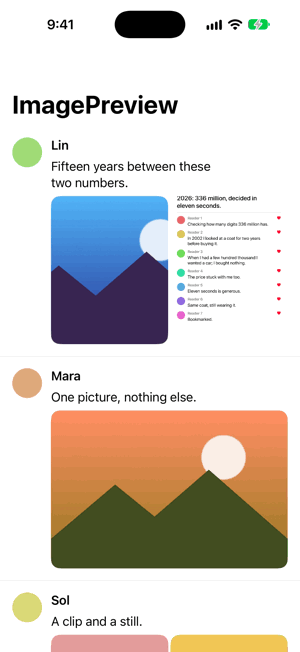
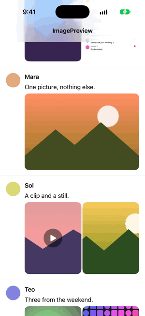
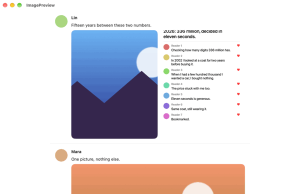
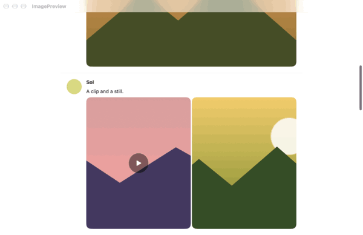

# ImagePreview

Tap a thumbnail and the photo grows right out of it. Swipe through the rest, pinch to look closer, and when you're done, flick it away: it flies straight back into its thumbnail. It's the full-screen viewer you know from Photos and X, for SwiftUI, UIKit and AppKit, made to feel right under your finger.

<p align="center">
  
  &nbsp;&nbsp;
  
</p>

<p align="center">
  
  
</p>

## What it feels like

- **It comes from where you tapped.** The photo grows out of its thumbnail, crop and rounded corners included, and lands back in exactly the same spot. While it's open, the thumbnail steps aside, so there's never two of it.
- **It follows your finger.** Drag a photo down (or up, or sideways past the last one) and it moves with you, shrinking around the point you grabbed while the screen underneath shows through. Let go: a real flick sends it home, a hesitant one springs it back.
- **You can't catch it out.** Every movement is a spring on the same state. Grab a photo mid-flight, scroll the page while it's landing, change your mind halfway: it never jumps.
- **No waiting.** The flight starts on the very frame you tap, from the thumbnail you already have. Full-size images decode off the main thread and fade in when they're ready.
- **Videos come alive.** A video keeps playing while it opens, while you drag it and while it flies home. And anything else that can draw itself (a live photo, a document, your own player) can be a page too.
- **It's a real page.** Not an overlay pretending to be one: on iOS it has the system's own navigation bar and toolbar, and on the Mac it borrows the window's title bar while it's open, in the window's own style.
- **Everywhere.** iPhone, iPad, Mac (native AppKit and Mac Catalyst) and Apple Vision Pro.

| | iOS · iPadOS · Catalyst · visionOS | macOS |
|---|---|---|
| Next and previous | swipe | two-finger swipe, drag, ← → |
| Zoom | pinch, double-tap | pinch, double-click |
| Close | drag up or down, or sideways past the first or last image; the close button | the same with two fingers or the mouse; click outside the image, Esc, Space |
| Bars | tap to hide and show | click the image to hide and show |

## Quick start

Two modifiers: one on each thumbnail, so the viewer knows where to fly from, and one on any view that contains them.

```swift
import ImagePreview

ForEach(photos) { photo in
    Thumbnail(photo)
        .imagePreviewSource(photo.id, cornerRadius: 12)
        .onTapGesture { opened = photo.id }
}
.imagePreview(selection: $opened, items: photos) { photo in
    PreviewImage(url: photo.url, placeholder: photo.thumbnail)
}
```

That's it. The sections below cover the rest: buttons on the bars, UIKit and AppKit, videos, and content of your own.

## Installation

Swift Package Manager:

```swift
.package(url: "https://github.com/Eirperuier/ImagePreview.git", from: "0.4.0")
```

Requires iOS 17, Mac Catalyst 17, macOS 14 or visionOS 1.

## SwiftUI

A complete gallery. Mark each thumbnail with `imagePreviewSource`, and attach `imagePreview` to a view that contains them:

```swift
import ImagePreview

struct Gallery: View {
    let photos: [Photo]
    @State private var opened: Photo.ID?

    var body: some View {
        LazyVGrid(columns: columns) {
            ForEach(photos) { photo in
                Image(uiImage: photo.thumbnail)
                    .resizable()
                    .scaledToFill()
                    .frame(height: 120)
                    .clipShape(RoundedRectangle(cornerRadius: 12, style: .continuous))
                    .imagePreviewSource(photo.id, cornerRadius: 12)
                    .onTapGesture { opened = photo.id }
            }
        }
        .imagePreview(selection: $opened, items: photos) { photo in
            PreviewImage(url: photo.url, placeholder: photo.thumbnail)
        }
    }
}
```

`selection` stays in step with the viewer: swiping changes it, closing sets it to `nil`, and setting it to `nil` yourself closes the viewer.

### Actions

Buttons for the image on screen go beside the close button, where each platform puts a page's buttons: on iOS on the navigation bar; on the Mac on the window's toolbar if it has one, at the end of its title bar if not.

```swift
.imagePreview(selection: $opened, items: photos) { photo in
    PreviewImage(url: photo.url, placeholder: photo.thumbnail)
} actions: { photo in
    ShareLink(item: photo.url)
}
```

### The page

On iOS, iPadOS, Mac Catalyst and visionOS the viewer is a page in its own navigation controller. It has the system close button on the navigation bar and, for several images, where you are as the title. Dress the page yourself with the `page` closure: its `.toolbar` and `.navigationTitle` go on the system bars, which a tap hides and shows and a drag fades. `page.context` gives the index, the count, `dismiss()` and `select(_:)`:

```swift
.imagePreview(selection: $opened, items: photos) { photo in
    PreviewImage(url: photo.url, placeholder: photo.thumbnail)
} page: { page in
    page.navigationTitle(photos[page.context.index].title)
        .toolbar {
            ToolbarItem(placement: .bottomBar) {
                ShareLink(item: photos[page.context.index].url)
            }
        }
}
```

On macOS the viewer lays itself over the window's content, and while the images cover the window its title bar is the page's, drawn dark over the backdrop. The window keeps its style: macOS draws a window with a toolbar with larger corners than one with a compact title bar, so a window with a toolbar shows the page's toolbar (the close button, the actions and the page's `.toolbar`), and one without keeps its compact title bar, with the page's title and the actions and close button at its end; there the page's `.toolbar` is not shown. The window gets its own title bar back as soon as anything of it shows through, when an image is dragged or the viewer closes.

## UIKit and AppKit

```swift
let preview = ImagePreviewController(count: photos.count, index: tappedIndex) { index in
    PreviewImage(url: photos[index].url, placeholder: cells[index].imageView.image)
} source: { index in
    collectionView.cellForItem(at: IndexPath(item: index, section: 0)).map {
        PreviewSource(view: ($0 as! PhotoCell).imageView, cornerRadius: 8)
    }
}
preview.onIndexChange = { index in
    collectionView.scrollToItem(at: IndexPath(item: index, section: 0), at: .centeredVertically, animated: false)
}
preview.present(from: view)
```

The source closure is asked again when the viewer closes, so after scrolling the collection view to the image on screen, the image lands in the right cell. If there is no thumbnail on screen, the image fades out where it is.

On iOS, put buttons on the bars through `preview.page.navigationItem` and `preview.page.toolbarItems`; on macOS, set `preview.title` and `preview.actionsView`. On both, `setPage(actions:_:)` builds the page in SwiftUI before presenting.

## Images

`PreviewImage` is what to show for one item:

- `PreviewImage(image)`: an image in memory.
- `PreviewImage(url:placeholder:)`: a remote or file URL, decoded off the main thread (orientation applied, longest side at most 4096 px) and kept in a small cache.
- `PreviewImage(placeholder:load:)`: your own loader.

Pass the thumbnail you already have as the `placeholder`: the transition starts from it on the first frame and the full image fades in when it arrives. Without one, the viewer takes a picture of the thumbnail as it is on screen and starts from that, so it never waits.

The thumbnail can be any view: `Image`, `AsyncImage`, Kingfisher's `KFImage`, SDWebImage's `WebImage`. To load the full image with your own image library, use `PreviewImage(placeholder:load:)`:

```swift
PreviewImage(placeholder: ImageCache.default.retrieveImageInMemoryCache(forKey: photo.thumbnailURL.absoluteString)) {
    try await KingfisherManager.shared.retrieveImage(with: photo.url).image
}
```

## Videos

`PreviewVideo(url:poster:)` is a video, a file or a remote URL AVFoundation can play. It flies in and out of its thumbnail playing, starting from its `poster` (the thumbnail) or its first frame. It plays while it is on screen, flying and dragged too, from the start again when it ends, and pauses when you move to another page or it has closed.

Return `PreviewMedia` where an item can be an image or a video:

```swift
.imagePreview(selection: $opened, items: posts) { item in
    item.isVideo
        ? .video(PreviewVideo(url: item.url, poster: item.thumbnail))
        : .image(PreviewImage(url: item.url, placeholder: item.thumbnail))
}
```

There are no playback controls built in yet; put your own on the bars with `actions` or `page`.

## Your own content

Anything else, or a video played your own way, is a `PreviewContent`: the viewer flies, drags, pages and zooms it, and the content says what is shown.

- `still()`: a picture of the content as it is now. It flies when there is nothing better, and its size is the content's shape.
- `makeView(for:)`: a view over the still, laid out at its size, zoomed and clipped with it, on the page and in flight; or nil for the still alone (a web page you would rather not resize every frame flies as its still).
- `setState(_:)`: `.onScreen`, `.moving` (flying or dragged) or `.offScreen`, as it changes.
- `load(changed:)` and `cancel()`: get a better still, and stop when the viewer closes.

For a video that keeps playing in your feed, give the viewer the feed's player: the page and the flight show the same frames as the thumbnail, and it lands on the frame the thumbnail is showing.

```swift
final class FeedVideo: PreviewContent {
    let item: FeedItem
    init(_ item: FeedItem) { self.item = item }

    func still() -> UIImage? { item.player.currentFrame ?? item.poster }
    func makeView(for place: PreviewContentPlace) -> UIView? { PlayerView(item.player) }
    func setState(_ state: PreviewContentState) {
        if state == .offScreen { item.player.pause() } else { item.player.play() }
    }
}

.imagePreview(selection: $opened, items: items) { item in
    PreviewMedia.content(FeedVideo(item))
}
```

## Configuration

```swift
var configuration = ImagePreviewConfiguration()
configuration.backgroundColor = CGColor(gray: 0, alpha: 1)
configuration.pageSpacing = 16
configuration.maximumZoomScale = 4
configuration.transitionSpring = PreviewSpring(response: 0.36, dampingRatio: 1)
configuration.restoreSpring = PreviewSpring(response: 0.32, dampingRatio: 0.86)
configuration.tapTogglesAccessories = true   // the bars; false: a tap closes the viewer
```

With Reduce Motion on, the viewer fades in and out in place instead of flying.

## Example

`Example/ImagePreviewExample.xcodeproj` is the feed in the recordings above: posts with one to five images drawn on the device, a clip made on the device, and a post loaded from the network. It runs on iPhone, iPad, Mac and Vision Pro, offline. `ImagePreviewExampleUITests` drives the gestures at finger speed; record the simulator while it runs (`xcrun simctl io booted recordVideo`) to watch them frame by frame.

## License

MIT
